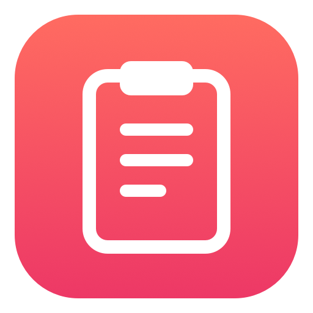
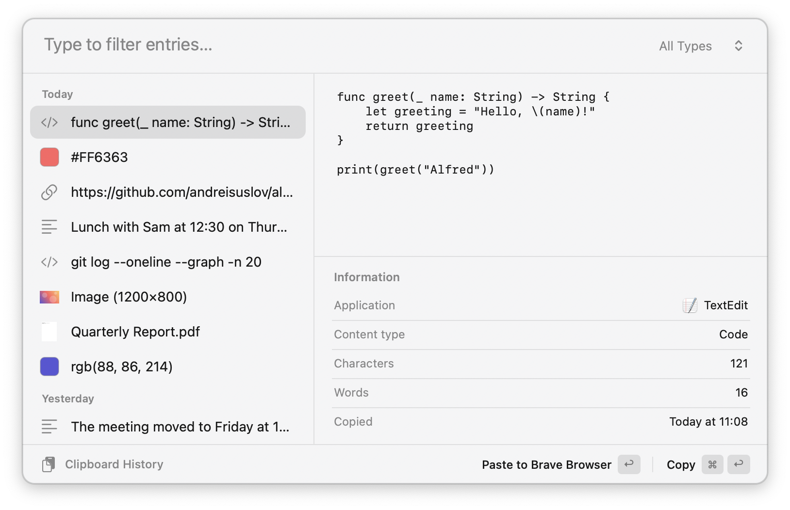
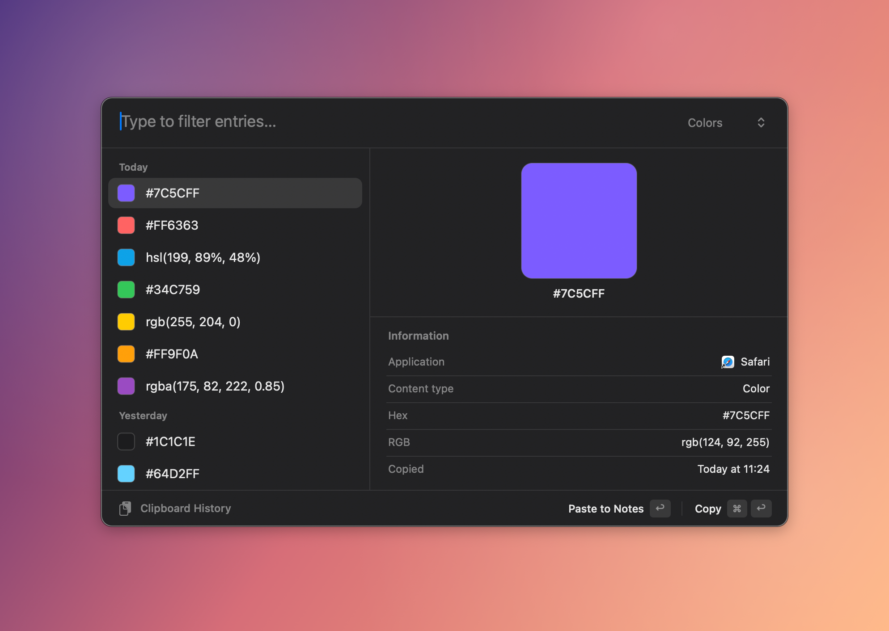

#  Clipboard History Alfred Workflow

A Raycast-style window for Alfred's clipboard history

[⤓ Download the workflow](https://github.com/andreisuslov/alfred-clipboard-history/releases/latest)

## Usage

Open the window with <kbd>⌃</kbd><kbd>⌘</kbd><kbd>V</kbd> or the `clipboard` keyword. Everything in Alfred's clipboard history is listed by day, with a preview and details of the selected item on the right. Type to filter, or pick Text, Links, Code, Media (images and files) or Colors from the menu at the top right.

* <kbd>↩</kbd>: Paste into the app you were in.
* <kbd>⌘</kbd><kbd>↩</kbd>: Copy without pasting.
* <kbd>↑</kbd><kbd>↓</kbd>: Move through the list while typing.
* <kbd>esc</kbd>: Close the window.
* Drag a row out of the window to drop it anywhere: text drags as text, images and files as files.
* Drag the window by its background to move it. It opens there next time.

It follows light and dark mode. Colors show as swatches, with their Hex and RGB values:

Requires Alfred 5 with the Powerpack and Clipboard History turned on (turn on its Images and Files options to see those too), on macOS 13 or later.

## How it works

The window is a small app that comes with the workflow (`ClipHistory.app`). It only reads Alfred's clipboard history, so Alfred keeps recording as usual. It starts at login, so the hotkey works right away, by adding `~/Library/LaunchAgents/com.andreisuslov.alfred-clipboard-history.plist`. To paste, it asks Alfred to press <kbd>⌘</kbd><kbd>V</kbd>, so it needs no permissions of its own.

The app isn't notarized. If macOS won't open it after you install the workflow, go to System Settings → Privacy & Security and choose Open Anyway, or right-click the workflow in Alfred Preferences, choose Open in Finder, and run `xattr -dr com.apple.quarantine .` in Terminal from that folder.

To remove it, delete the workflow in Alfred, quit Clipboard History in Activity Monitor, and delete the LaunchAgent file above.

## Building

`Workflow/source/build.sh` compiles the app from `Workflow/source/ClipboardHistory.swift` with the Xcode Command Line Tools. With `--package` it also writes `dist/clipboard-history.alfredworkflow`.
